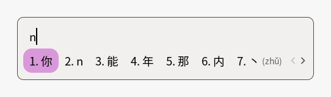
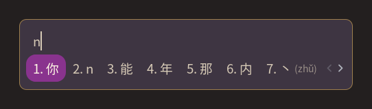

# fcitx5

Fcitx5 输入法配置与主题。

## 主题

`themes/` 下有两套自绘主题，颜色全部来自 `palette/README.md`，不引入新色：

| 主题 | 适用 | 面板底 | 正文 | 选中底 / 字 | 描边 |
|---|---|---|---|---|---|
| `palette-light` | 亮色 | `surface` `#F2F0EF` | `fg` `#000000` | `purple-light` `#D998D9` / `fg` | `gold` `#5C4824` |
| `palette-dark` | 暗色 | `surface` `#3E3542` | `fg` `#D6CAB6` | `purple` `#89338E` / `cream` `#FFF7E4` | `gold` `#9D7E4D` |

实际渲染（隔离 Wayland 会话里用 fcitx5 1x 输出截图，不是 mock）：





细节：

- 面板 / 菜单圆角：10px。
- 选中块为**大圆角矩形**：`80×40`，`rx 14 / ry 14`；左右各保留 12px 直线段（40 - 2×14），不是胶囊。
- `HighlightMargin` 左右 10 / 上下 6，`TextMargin` 左右 10 / 上下 6。
- 边缘留白：候选面板 `ContentMargin` 左右 10 / 上下 8。
- 输入法切换提示是 `InputPanel` 的 overlay message，和候选共用同一套 `[InputPanel]` 样式，fcitx 没有单独的配置；要隐藏可在全局 config 的 `[Behavior]` 里设 `ShowInputMethodInformation=False`。
- 菜单单独一套：`ContentMargin` 8 / 8，`TextMargin` 8 / 8 / 4 / 4，独立 `menu-highlight.svg`（小圆角），不再受候选面板的大 margin 影响。
- 候选序号 / 注释用 `muted`；暗色下固定用冷灰 `#B0B4BC`，与暖米正文区分。
- 分页箭头、子菜单箭头用 `muted`；菜单勾选点用 accent（亮色 `purple` / 暗色 `purple-light`）。
- 不透明、不启用模糊；面板直接压 `surface`，边框是 1px `gold` 细线。
- 预编辑高亮段落：亮色 `highlight` `#E9DBF2` + `fg`，暗色 `purple` + `cream`。

## 切换

默认跟随系统明暗（XDG `org.freedesktop.appearance` `color-scheme`）：

```ini
Theme=palette-light
UseDarkTheme=True
DarkTheme=palette-dark
```

想固定其中一个模式，把 `UseDarkTheme` 设为 `False`，只留 `Theme=` 即可（例如 `Theme=palette-dark`）。改完执行 `fcitx5-remote -r` 热重载，也可以在 `fcitx5-config-qt` → 附加组件 → Classic UI 里选。

`module.sh` 会把两套主题都装到 `~/.local/share/fcitx5/themes/`。不再安装 `fcitx5-breeze`。
